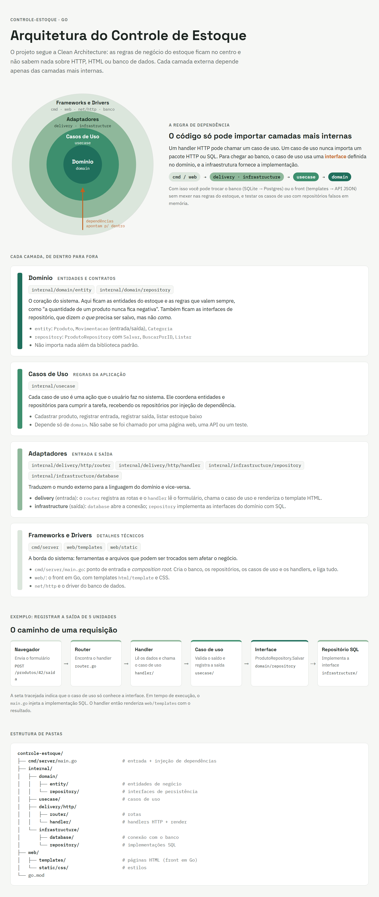

# Controle de Estoque

Aplicação web em Go, com back-end e front-end em Go (`net/http` + `html/template`), organizada em Clean Architecture.

## Como rodar

Requisito: Go 1.23 ou mais novo.

```sh
go run ./cmd/server
```

Acesse http://localhost:8080. Execute o comando na raiz do projeto, pois os templates são carregados de `web/`.

## Arquitetura



A versão em HTML do diagrama está em [docs/arquitetura.html](docs/arquitetura.html).

### Regra de dependência

O código só pode importar camadas mais internas:

```
cmd / web  →  delivery · infrastructure  →  usecase  →  domain
```

Os casos de uso acessam o banco apenas por interfaces definidas no domínio. A infraestrutura implementa essas interfaces, e o `main.go` injeta as implementações. Assim é possível trocar o banco ou o front sem mexer nas regras de negócio, e testar os casos de uso com repositórios em memória.

### Camadas

| Camada | Pastas | Responsabilidade |
| --- | --- | --- |
| **Domínio** | `internal/domain/entity`, `internal/domain/repository` | Entidades do estoque (Produto, Movimentação, Categoria), regras que valem sempre e interfaces de persistência. Não depende de nenhuma outra camada. |
| **Casos de Uso** | `internal/usecase` | Ações do sistema: cadastrar produto, registrar entrada e saída, listar estoque baixo. Depende só do domínio. |
| **Adaptadores** | `internal/delivery/http/router`, `internal/delivery/http/handler`, `internal/infrastructure/database`, `internal/infrastructure/repository` | Entrada: rotas e handlers HTTP que chamam os casos de uso e renderizam o HTML. Saída: conexão com o banco e implementações SQL dos repositórios. |
| **Frameworks e Drivers** | `cmd/server`, `web/templates`, `web/static` | Ponto de entrada e composição das dependências, templates e CSS do front, `net/http` e driver do banco. |

### Fluxo de uma requisição

Exemplo: registrar a saída de 5 unidades de um produto.

```
Navegador ─POST /produtos/42/saida→ Router → Handler → Caso de uso → ProdutoRepository (interface)
                                                                              ⇣ implementada por
                                                                     Repositório SQL → Banco
```

O handler então renderiza `web/templates` com o resultado.

### Estrutura de pastas

```
controle-estoque/
├── cmd/server/main.go              # entrada + injeção de dependências
├── internal/
│   ├── domain/
│   │   ├── entity/                 # entidades de negócio
│   │   └── repository/             # interfaces de persistência
│   ├── usecase/                    # casos de uso
│   ├── delivery/http/
│   │   ├── router/                 # rotas
│   │   └── handler/                # handlers HTTP + render
│   └── infrastructure/
│       ├── database/               # conexão com o banco
│       └── repository/             # implementações SQL
├── web/
│   ├── templates/                  # páginas HTML (front em Go)
│   └── static/css/                 # estilos
├── docs/                           # diagrama da arquitetura
└── go.mod
```
